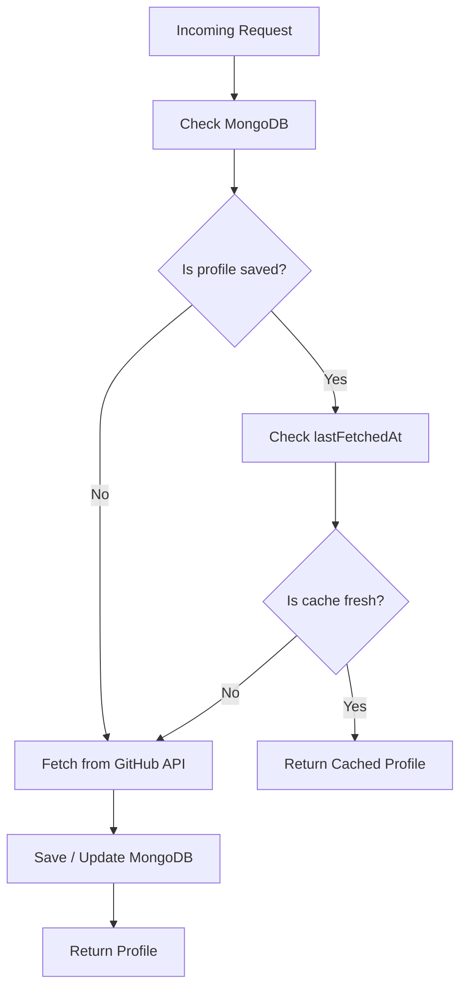

# GitHub Profile Explorer

A backend application that fetches GitHub user profiles using the GitHub REST API and stores them in MongoDB with a time-based caching mechanism.

## Tech Stack

- Node.js
- Express.js
- MongoDB
- Mongoose
- GitHub REST API

## Features

- Fetch GitHub user profiles.
- Store and update profiles in MongoDB.
- Implement 6-hour cache-based retrieval.
- Force refresh using `?refresh=true`.
- Validate GitHub usernames using middleware.
- Centralized error handling.

## Caching Strategy

Uses a **6-hour time-based cache** to reduce unnecessary GitHub API requests.

- **Cache Miss:** Fetch the profile from GitHub and save it in MongoDB.
- **Cache Hit:** Return cached data if it is less than 6 hours old.
- **Cache Expired:** Fetch fresh data and update the existing MongoDB document.
- **Force Refresh:** Use `?refresh=true` to bypass the cache and fetch the latest profile.

## Caching Workflow



**Note:** The `?refresh=true` query parameter bypasses the cache and fetches the latest profile directly from GitHub.

## API Endpoints

| Method | Endpoint | Description |
|---|---|---|
| GET | `/api/github/users/:username` | Fetch profile using cache |
| GET | `/api/github/users/:username?refresh=true` | Force refresh profile |
| GET | `/api/github/saved-user/:username` | Retrieve saved profile |

## Setup

Clone the repository:

```bash
git clone YOUR_REPOSITORY_URL
cd github-api-learning
npm install
```

Create a `.env` file in the project root:

```env
PORT=3000
MONGODB_URI=your_mongodb_connection_string
GITHUB_TOKEN=your_github_token
```

`GITHUB_TOKEN` is optional for accessing public profiles, but helps with GitHub API rate limits.

Start the development server:

```bash
npm run dev
```

## Key Learnings

- REST API integration
- Express middleware and routing
- Controller-service architecture
- MongoDB and Mongoose CRUD operations
- Upsert operations
- Time-based caching
- Input validation and error handling
